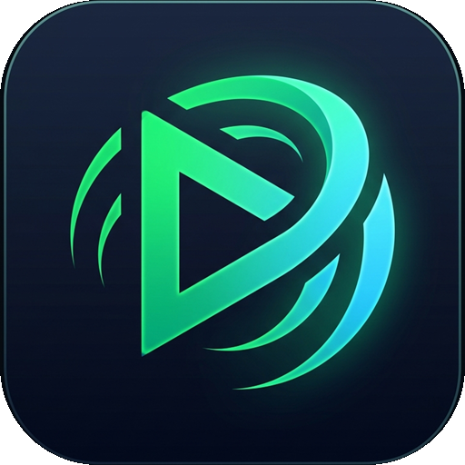

<p align="center">
  
</p>

<h1 align="center">MatchFlow TV</h1>

<p align="center">
  <strong>Din automatiska sport-TV för Windows (HDMI)</strong><br/>
  Samlar all pågående livesport från dina streamingtjänster, rangordnar efter dina favoritlag, ligor och sporter och visar alltid rätt match i fullskärm.<br/>
  <sub>Skapad av <a href="https://www.s4m.dev/">S4m.dev</a></sub>
</p>

<p align="center">
  <a href="../../releases/latest"><strong>⬇️ Ladda ner senaste Windows-versionen (.zip)</strong></a>
</p>

---

## Kom igång på 30 sekunder (ingen kod eller .NET krävs)

1. Gå till **[Releases](../../releases/latest)** här på GitHub och ladda ner **`MatchFlowTV-win-x64.zip`**.
2. Packa upp mappen (t.ex. till `C:\MatchFlowTV`).
3. Dubbelklicka på **`MatchFlowTV.exe`**!
   > *Tips: Eftersom filen är open source utan betalt kodcertifikat kan Windows SmartScreen visa en varning första gången – klicka på **Mer information → Kör ändå**.*
4. Tryck **`L`** för att logga in en gång på dina streamingtjänster (SVT Play kräver ingen inloggning).
5. Tryck **`R`** för att lägga till dina favoritlag, ligor och sporter i den ordning du vill.

**Systemkrav:** Windows 10 eller Windows 11 (64-bit) med Microsoft Edge WebView2 (ingår redan i Windows 11 och de flesta Windows 10-datorer).

---

## Streamingtjänster som stöds

| Tjänst | Inloggning | Exempel på sport |
| --- | --- | --- |
| **SVT Play** | Krävs ej | Vinterstudion, fotboll, handboll, friidrott |
| **TV4 Play** | Eget konto | Allsvenskan, SHL, HockeyAllsvenskan, Champions League |
| **Viaplay** | Eget konto | Premier League, Formel 1, NHL, vintersport |
| **HBO Max** | Eget konto (+ Sport) | Eurosport: Grand Slam-tennis, Tour de France, PGA Tour, vintersport, speedway, motorsport |
| **Expressen Livesport** | Eget `+Allt`-konto | Hockeyettan, Elitettan, SSL, Bandy, SBL |
| **Disney+** | Eget konto | Europa League, Conference League, La Liga, NHL |
| **Prime Video** | Eget konto | Premier League & utvalda livesändningar |
| **Netflix** | Eget konto | NFL, WWE & live-event |

---

## Funktioner

- **Smart rangordning & minuspoäng:** Lag väger tyngst → Ligor → Sporter → Tjänst-prioritet, med egna minuspoäng för att nedprioritera t.ex. studioprogram, kval eller specifika ligor/lag utan att dölja dem, samt dubblettfilter mellan tjänster.
- **Riktig helbild i spelaren (`T`):** Sträcker aktiv videospelare kant-till-kant så att sajternas menyer och sidofält försvinner – med hårdvaru-DRM (PlayReady/Widevine) via Edge WebView2.
- **Kontinuerlig sport-TV:** Byter automatiskt vidare när nuvarande sändning tar slut och visar diskret 15-sekunders notis om en högre prioriterad toppmatch drar igång.
- **Watchdog & nätverksåterhämtning:** Laddar automatiskt om strömmen om bilden fryser i buffring eller om nätverket tappas tillfälligt – och byter vidare om strömmen inte svarar.
- **OLED-säker animerad TV-skärmsläckare (`Z`):** 3 roliga stilar (byt live med `←`/`→` eller i `R`): **⚽ Sportstuds** (DVD-studsande neonlogga med skiftande sportikoner, gnistor och hörnträff-fyrverkeri!), **🏟️ Arenatavla** (strålkastare + levande sekundnedräkning till nästa match) och **✨ Stjärnplan** (stjärnhimmel & svävande sportikoner) – samt extra mörkt OLED-läge. Vaknar direkt till fullskärm så fort nästa match startar.
- **Nattläge ("Tysta timmar"):** Stoppar automatisk uppspelning nattetid (t.ex. `23:30–07:00`) samtidigt som du fortfarande kan välja matcher manuellt i guiden.
- **Volym & sportfilter per tjänst:** Balansera ljudnivån direkt via volymslidern i OSD:n eller i `L`, och stäng av enskilda sporter på specifika tjänster (t.ex. stäng av Ishockey på TV4 Play men behåll Ishockey på Viaplay/Expressen).
- **Visuell live-skanner (`V`):** Se i realtid exakt vilken webbsida skannern laddar för varje tjänst (SVT Play, TV4 Play, Viaplay, Disney+, Expressen m.fl.), byt tjänst med ett klick och se extraktor, URL och sidstatus direkt på skärmen.
- **Automatiska uppdateringar från GitHub:** Appen kollar automatiskt efter nya GitHub-releaser, verifierar `SHA256SUMS.txt` kryptografiskt och uppdaterar `MatchFlowTV.exe` i bakgrunden när ingen match spelas – med alla dina inloggningar och rangordningar helt orörda.

---

## Fjärrkontroll & snabbkommandon

| Tangent | Funktion |
| --- | --- |
| **`G` / `Tab`** | Öppna Sportguiden (bläddra med **`Upp`/`Ner`**, välj med **`Enter`**) |
| **`R`** | Rangordning, Nattläge, Skärmsläckare, Dubblettfilter & Autostart |
| **`L`** | Tjänster, inloggning, volym per tjänst, rensa session & skannerdiagnostik |
| **`V`** | Öppna/stäng visuell live-skanner (se exakt vad appen skannar i realtid) |
| **`N` / `PageUp`** | Nästa högst rankade match |
| **`B` / `PageDown`** | Föregående match |
| **`S`** | Hoppa över denna match resten av sessionen |
| **`P`** | Lås nuvarande match så automatik inte avbryter den |
| **`M` / `Mute`** | Ljud av/på |
| **`T`** | Växla helbild (teaterläge) / sajtvy i spelaren |
| **`I` / Rör musen** | Visa TV-infomenyn längst ned |
| **`Z`** | Starta TV-skärmsläckaren (`←`/`→` byter stil live) |
| **`Home`** | Gå tillbaka till startsidan (pausar live-TV) |
| **`F11`** | Växla helskärmsläge |
| **`Esc`** | Stäng aktiv meny / avbryt automatiskt byte |

---

## Säkerhet & skonsam trafik

- **Inga lagrade lösenord eller nycklar:** Inloggning sker direkt i isolerade lokala WebView2-profiler (`%LocalAppData%\AutomatiskSportTV\Profiles`) med Windows DPAPI-kryptering och NTFS-behörighet begränsad till ditt Windows-konto.
- **Strikt HTTPS & domänlås:** Automatisk uppspelning och skanning tillåter bara `https://` mot tjänsternas betrodda domäner, rensar query-tokens och blockerar känsliga webbläsarrättigheter (kamera, mikrofon, plats, notiser, urklipp).
- **Låg och skonsam trafik:** Standardintervallet är 5 minuter (minst 2 minuter) med paus mellan varje tjänst, ingen pollning mot oinloggade konton, automatisk nedkylning vid fel/verifiering och max en aktiv ström åt gången.

---

## För utvecklare & publicering på GitHub

### Bygga och köra lokalt
Kräver [.NET 10 SDK](https://dotnet.microsoft.com/download):
```powershell
dotnet test AutomatiskSportTV.sln -c Release
.\Start-MatchFlowTV.bat
```

### Skapa en nedladdningsbar release (och skicka ut uppdatering till alla användare)
**Alternativ A – Automatiskt via GitHub Actions (rekommenderas):**
1. Ladda upp projektet till ett GitHub-repository.
2. När du vill släppa en uppdatering räcker det att antingen:
   - Ändra `<Version>` (t.ex. från `1.0.0` till `1.0.1`) i `src\AutomatiskSportTV.App\AutomatiskSportTV.App.csproj` och göra `git push` till `main`, **eller**
   - Skapa och pusha en versionstagg:
     ```powershell
     git tag v1.0.1
     git push origin v1.0.1
     ```
3. GitHub Actions ([.github/workflows/release.yml](.github/workflows/release.yml)) bygger automatiskt en ny fristående `MatchFlowTV-win-x64.zip` (med ditt GitHub-repo inbakat för auto-uppdatering) + `SHA256SUMS.txt` och publicerar den under **Releases**. Alla som redan har appen nedladdad får då uppdateringen automatiskt!

**Alternativ B – Bygg zip-paketet lokalt på din dator:**
Dubbelklicka på `scripts\Build-Release.bat` (eller kör `.\scripts\Build-Release.ps1 -Version 1.0.0`).
Filerna hamnar i `dist\MatchFlowTV-win-x64.zip` och `dist\SHA256SUMS.txt`, färdiga att ladda upp direkt på GitHub Releases.

---

## Skapare, licens & tredjepartsnotiser
Skapad av **[S4m.dev](https://www.s4m.dev/)** — Copyright 2026 [S4m.dev](https://www.s4m.dev/).

Publicerad under [Apache License 2.0](LICENSE). Se [NOTICE](NOTICE) för tredjepartslicenser (Microsoft Edge WebView2 SDK, .NET 10 / WPF) samt varumärkes- och ansvarsfriskrivning.
